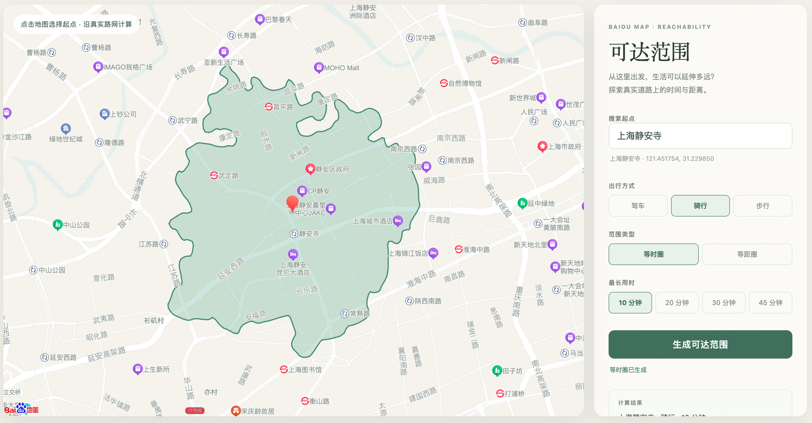
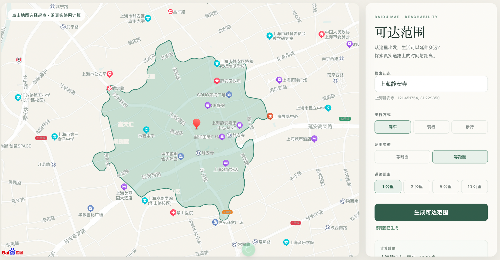

# 百度地图可达范围 Demo | Baidu Map Reachability Demo

[简体中文](#简体中文) · [English](#english)

---

## 简体中文

这是一个面向百度地图 API 开发者的端到端示例，演示如何将百度地图 JSAPI 4.0 的地图交互能力，与百度地图 WebAPI 的等时圈、等距圈计算服务组合起来。用户选择起点、出行方式和时间 / 距离阈值后，服务端请求百度 WebAPI 获取道路网络可达边界，再由浏览器将边界绘制在 JSAPI 地图上。

项目重点是展示 API 串接方式，而不只是地图效果：浏览器负责地图加载、地点搜索、坐标拾取和结果可视化；Node.js 服务端负责保存 WebAPI AK、校验请求、转换参数并代理百度接口。项目默认运行在本机，适合学习和验证调用流程，不是可直接公网部署的生产服务。

### 效果预览

**等时圈（骑行 10 分钟）**



**等距圈（驾车 1 公里）**



### 功能

- 使用百度地图 JSAPI 4.0 展示地图、地点搜索和起点选取。
- 通过百度 WebAPI 计算真实道路网络等时圈与等距圈。
- 支持驾车、骑行、步行，以及 10 / 20 / 30 / 45 分钟和 1 / 3 / 5 / 10 公里选项。
- 展示计算结果、边界点数量和请求耗时，并自动调整地图视野。
- 服务端 AK 保留在 Node.js 服务端；浏览器端 AK 仅用于加载 JSAPI，应在百度地图控制台配置访问白名单。

> 为了改善显示效果，地图上的多边形轮廓经过轻量平滑；它仅用于视觉展示，不是原始边界的逐点精确呈现。等距圈表示沿道路计算的可达范围，不是以起点为中心的直线半径。

### API 集成流程

1. **加载 JSAPI 4.0**：前端从本地 `/api/config` 获取浏览器端 AK，并以回调方式加载百度地图 JavaScript API。此 AK 会用于浏览器请求，必须在开放平台配置合适的来源白名单。
2. **获取起点**：用户可以通过地图点击选取坐标，或使用 JSAPI `LocalSearch` 搜索地点。地图交互使用 `BMap.Point`，本项目传给服务端的坐标按百度经纬度坐标系 `bd09ll` 处理。
3. **调用本地代理**：前端向 `POST /api/reachability` 发送起点、范围类型、出行方式和阈值。服务端校验输入后，使用仅存在于 Node.js 进程环境中的服务端 AK 请求百度 WebAPI。
4. **映射接口参数**：等时圈请求 `/logistics_truck/v1/isochrone`，并将分钟换算成 `timeLimit` 秒；等距圈请求 `/logistics_truck/v1/isodistance`，`distanceLimit` 使用米。两类请求均传递 `profile`、起点以及 `inputCrs=bd09ll`、`outputCrs=bd09ll`。
5. **绘制结果**：服务端解析百度返回的 `result.path`，将边界点列表返回给前端。前端转换为 `BMap.Point`，使用 `BMap.Polygon` 绘制，并通过地图视野调整展示完整范围。

本地代理请求示例：

```json
{
  "mode": "time",
  "profile": "bike_fastest",
  "limit": 10,
  "point": { "lng": 121.451754, "lat": 31.22985 }
}
```

`mode` 支持 `time` / `distance`；`profile` 支持 `car_fastest`、`bike_fastest`、`foot_fastest`。当前服务端只接受界面提供的固定阈值，避免任意参数被直接转发到百度接口。若在自己的应用中传入 WGS84 或 GCJ-02 坐标，请先转换为所声明的输入坐标系，勿将不同坐标系的经纬度混用。

### 环境要求

- Node.js `^20.19.0` 或 `>=22.12.0`。
- 百度地图 JSAPI 浏览器端 AK，以及已开通等时圈 / 等距圈权限的 WebAPI 服务端 AK。

### 本地运行

```bash
npm ci
cp .env.example .env.local
```

编辑 `.env.local` 并填入你自己的 AK：

```env
VITE_BMAP_JSAPI_AK=你的浏览器端AK
BMAP_WEBAPI_AK=你的服务端AK
PORT=3017
VITE_PORT=5173
ALLOWED_ORIGIN=http://127.0.0.1:5173
```

启动开发服务：

```bash
npm run dev
```

打开 <http://127.0.0.1:5173/>。Vite 前端通过本地代理访问 Node API；如果修改 `PORT`、`VITE_PORT`，也要同步更新 `ALLOWED_ORIGIN`。端口被占用时服务会报错退出，不会自动切换到另一个端口。

### 使用的百度接口

- 等时圈：`https://api.map.baidu.com/logistics_truck/v1/isochrone`
- 等距圈：`https://api.map.baidu.com/logistics_truck/v1/isodistance`

服务端将分钟转换为秒、距离以米为单位传给百度接口，并把返回边界点封装为 `{ "mock": false, "points": [...] }` 交给前端绘制。服务端返回的错误包含请求校验失败、百度接口错误或超时等情况；具体接口权限、参数限制、配额和计费以百度地图开放平台说明为准。

### 安全与隐私

- 不要提交 `.env`、`.env.local` 或包含真实 AK 的文件。`.gitignore` 已忽略本地环境文件、依赖目录、构建产物和 ZIP 文件。
- WebAPI 服务端 AK 绝不能放入前端源码或发布包；浏览器端 AK 会出现在浏览器请求中，务必为其配置域名白名单和适当配额。
- 本地 API 仅绑定 `127.0.0.1`，并限制浏览器来源、请求类型和请求体大小。来源校验不是身份认证。
- 本项目面向本地演示，**没有提供公网部署所需的身份认证、限流、监控或生产级密钥管理**。不要将此 API 服务直接暴露到公网。

### 构建

```bash
npm run build
```

前端构建产物位于 `dist/`。该产物不包含可独立运行的后端服务，部署时必须另外提供安全配置的 Node API。

### 许可证

当前仓库未附带开源许可证。公开上传前，请先确认是否添加许可证；未添加许可证时，默认不授予他人复制、修改或分发本项目的权限。

---

## English

An end-to-end example for Baidu Map API developers, showing how to combine the map interaction capabilities of Baidu Map JSAPI 4.0 with the isochrone and isodistance services in Baidu Map WebAPI. After the user selects an origin, travel mode, and time or distance limit, the server requests a reachable boundary along the road network and the browser renders it on the JSAPI map.

The focus is the API integration flow, not only the map visualization: the browser handles map loading, place search, coordinate selection, and result rendering; the Node.js service keeps the WebAPI AK server-side, validates requests, maps parameters, and proxies calls to Baidu. This project runs locally by default and is intended for learning and validating the integration flow, not as a production service ready for public deployment.

### Screenshots

**10-minute cycling isochrone**


**1-kilometer driving isodistance**


### Features

- Baidu Map JSAPI 4.0 for map rendering, place search, and origin selection.
- Baidu Map WebAPI for road-network isochrone and isodistance calculations.
- Driving, cycling, and walking modes; 10 / 20 / 30 / 45 minutes and 1 / 3 / 5 / 10 kilometers.
- Displays calculation details, boundary point count, and request duration; fits the map to the result.
- The server-side AK stays in the Node.js service. The browser AK is used to load JSAPI and should be restricted with an allowed-origin list in the Baidu Map console.

> The polygon is lightly smoothed for visual presentation; it is not a point-for-point rendering of the original boundary. An isodistance area follows roads and is not a straight-line radius around the origin.

### API integration flow

1. **Load JSAPI 4.0**: The frontend retrieves the browser AK from the local `/api/config` endpoint and loads the Baidu Maps JavaScript API with a callback. This AK is used in browser requests, so configure an appropriate allowed-origin list in the Baidu Map console.
2. **Get an origin**: The user can select a point on the map or search for a place with JSAPI `LocalSearch`. Map interactions use `BMap.Point`; this project sends coordinates in Baidu's `bd09ll` coordinate system.
3. **Call the local proxy**: The frontend sends the origin, reachability mode, travel profile, and limit to `POST /api/reachability`. After validation, the server calls Baidu Map WebAPI using a server AK held only in the Node.js process environment.
4. **Map API parameters**: Isochrone requests use `/logistics_truck/v1/isochrone`, converting minutes to `timeLimit` seconds. Isodistance requests use `/logistics_truck/v1/isodistance`, with `distanceLimit` in meters. Both requests include `profile`, the origin, `inputCrs=bd09ll`, and `outputCrs=bd09ll`.
5. **Render the result**: The server parses Baidu's `result.path` and returns the boundary points. The frontend converts them to `BMap.Point` instances, renders them with `BMap.Polygon`, and adjusts the viewport to show the full result.

Example request to the local proxy:

```json
{
  "mode": "time",
  "profile": "bike_fastest",
  "limit": 10,
  "point": { "lng": 121.451754, "lat": 31.22985 }
}
```

`mode` supports `time` and `distance`; `profile` supports `car_fastest`, `bike_fastest`, and `foot_fastest`. The server accepts only the limits exposed by the UI rather than forwarding arbitrary values to Baidu. If your application uses WGS84 or GCJ-02 coordinates, convert them to the declared input coordinate system first; do not mix coordinates from different systems.

### Requirements

- Node.js `^20.19.0` or `>=22.12.0`.
- A Baidu Map browser AK for JSAPI and a WebAPI server AK with isochrone / isodistance permissions enabled.

### Run locally

```bash
npm ci
cp .env.example .env.local
```

Edit `.env.local` and add your own keys:

```env
VITE_BMAP_JSAPI_AK=your_browser_AK
BMAP_WEBAPI_AK=your_server_AK
PORT=3017
VITE_PORT=5173
ALLOWED_ORIGIN=http://127.0.0.1:5173
```

Start the development servers:

```bash
npm run dev
```

Open <http://127.0.0.1:5173/>. Vite proxies API requests to the local Node service. If you change `PORT` or `VITE_PORT`, update `ALLOWED_ORIGIN` accordingly. The dev server fails if its configured port is occupied; it will not silently switch ports.

### Baidu APIs

- Isochrone: `https://api.map.baidu.com/logistics_truck/v1/isochrone`
- Isodistance: `https://api.map.baidu.com/logistics_truck/v1/isodistance`

The server converts minutes to seconds, sends distances in meters, and returns the boundary points as `{ "mock": false, "points": [...] }` for rendering. Errors may come from request validation, the Baidu API, or a timeout. Refer to Baidu Map Open Platform for current permissions, parameter limits, quotas, and fees.

### Security and privacy

- Never commit `.env`, `.env.local`, or files containing real AKs. `.gitignore` excludes local environment files, dependencies, build output, and ZIP files.
- Never put the WebAPI server AK in frontend source or a public release. The browser AK is visible in browser requests; configure allowed domains and appropriate quotas.
- The local API binds only to `127.0.0.1` and restricts browser origins, request content types, and body size. Origin checks are not authentication.
- This project is intended for local demos. It does **not** provide authentication, rate limiting, monitoring, or production-grade secret management for public deployment. Do not expose this API service directly to the public internet.

### Build

```bash
npm run build
```

The frontend build is written to `dist/`. It does not include a standalone backend; deployment requires a separately hosted and securely configured Node API.

### License

No open-source license is included yet. Choose and add a license before publishing. Without a license, no permission is granted to copy, modify, or distribute this project.
